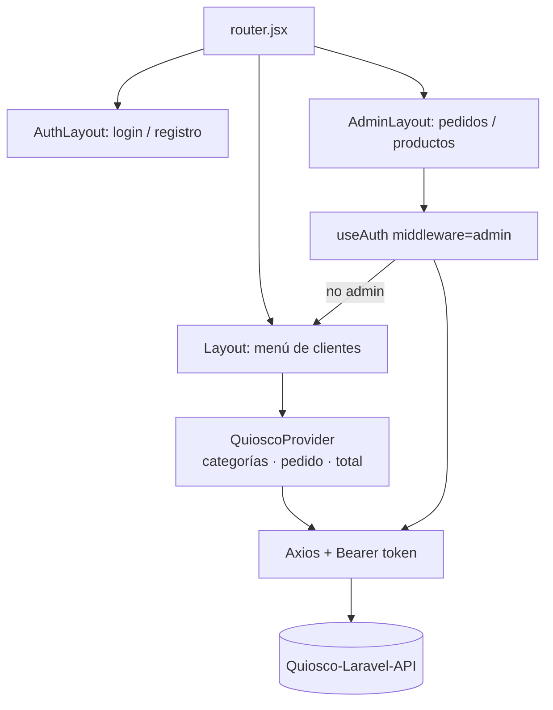

# Quiosco — Frontend (React)

Interfaz de un quiosco de comida: los clientes arman su pedido por categorías y el administrador gestiona pedidos y productos. Consume la API [Quiosco-Laravel-API](https://github.com/carlos-dev23/Quiosco-Laravel-API).

## Funcionalidades

- Menú por categorías con modal para elegir cantidad.
- Resumen del pedido: agregar, editar cantidad, eliminar y total calculado.
- Registro, login y logout con token de Sanctum.
- Panel de administración (`/admin`): pedidos pendientes y su completado, y administración de productos (disponibilidad).
- Rutas protegidas según sesión y rol (`admin`).
- Notificaciones con toasts.

## Stack

React 19 · Vite 8 · React Router 7 · Tailwind CSS 3 · Axios · SWR · react-modal · react-toastify

## Estructura

```
src/
├── components/   # Sidebar, Categoria, Productos, Resumen, ModalProducto, Alerta...
├── context/      # QuioscoProvider (estado global del pedido y categorías)
├── hooks/        # useAuth (sesión con SWR), useQuiosco
├── layouts/      # Layout, AuthLayout, AdminLayout
├── views/        # Inicio, Login, Registro, Ordenes, Productos
├── config/       # cliente Axios
└── router.jsx    # rutas: /, /auth/*, /admin/*
```

## Arquitectura



## Instalación

```bash
git clone https://github.com/carlos-dev23/Quiosco-React-FrontEnd.git
cd Quiosco-React-FrontEnd
npm install
echo "VITE_API_URL=http://localhost:8000" > .env
npm run dev
```

Requiere la API corriendo (ver su README).

## Scripts

| Comando | Descripción |
|---|---|
| `npm run dev` | Servidor de desarrollo |
| `npm run build` | Build de producción |
| `npm run lint` | ESLint |

## Siguientes pasos

- Centralizar el token en el cliente Axios (interceptor) en lugar de repetirlo en cada llamada.
- Pruebas de componentes con Vitest + Testing Library y CI con GitHub Actions.
